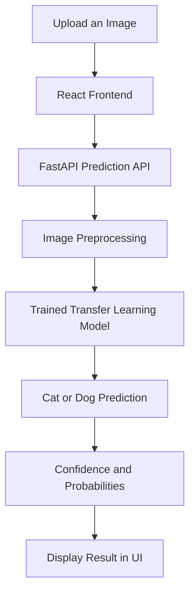

<div align="center">

# PetVision

### A simple way to tell who's in the picture.

A deep-learning web application that classifies images as cats or dogs using transfer learning.

<br/>


[Features](#-features) · [How It Works](#-how-it-works) · [Installation](#-getting-started) · [API](#-api-reference)

</div>

---

## About

**PetVision** is a cat and dog image classification project built with a React frontend and a Python-based FastAPI backend.

Upload an image, preview it, and let the trained model predict whether it contains a cat or a dog. The application also displays the model's confidence score and class probabilities.

The model uses transfer learning with a MobileNetV2 feature extractor, helping reuse pretrained visual features for this two-class classification task.

## Features

- **Image Upload** — Select an image from your device.
- **Image Preview** — Review the selected image before prediction.
- **AI Classification** — Predict whether the image contains a cat or a dog.
- **Confidence Score** — View the model's confidence for its prediction.
- **Class Probabilities** — Compare the predicted probabilities for both classes.
- **REST API** — Serve predictions through a FastAPI endpoint.
- **Responsive UI** — Use the interface on desktop and mobile screens.

## How It Works



### Prediction pipeline

1. The user selects an image.
2. The frontend sends it to the backend as multipart form data.
3. OpenCV decodes and resizes the image to `224 × 224` pixels.
4. The image is normalized and passed to the trained model.
5. The API returns the predicted class and probabilities.
6. The frontend displays the result.

## Tech Stack

| Area | Technologies |
|---|---|
| Frontend | React, Vite, CSS |
| Backend | Python, FastAPI, Uvicorn |
| Deep Learning | TensorFlow, TensorFlow Hub, tf-keras |
| Image Processing | OpenCV, NumPy |
| Model Architecture | MobileNetV2 feature extractor with a two-class output layer |
| Deployment | Vercel (frontend), Render (backend) |


## 📓 Model Training Notebook

The Jupyter Notebook (`.ipynb`) included in this repository is provided for reference to document the model training and experimentation process.

**Note:** The notebook is not required to run the web application. The application uses the pre-trained model file (`dog_cat_model.h5`) for predictions through the FastAPI backend.

## Project Structure

```text
dog-cat-ai/
├── backend/
│   ├── main.py
│   ├── requirements.txt
│   └── dog_cat_model.h5
├── frontend/
│   ├── src/
│   │   ├── App.jsx
│   │   ├── index.css
│   │   └── main.jsx
│   ├── package.json
│   └── index.html
├── .gitignore
└── README.md
```

*The structure above is illustrative; filenames may differ in your local project.*

## Getting Started

### Prerequisites

- Python 3.13 with compatible project dependencies
- Node.js and npm
- Git (optional)

### 1. Clone the repository

```bash
git clone YOUR_GITHUB_REPOSITORY_URL
cd dog-cat-ai
```

Replace `YOUR_GITHUB_REPOSITORY_URL` with your actual repository URL.

### 2. Set up the backend

Open a terminal in the project root:

```bat
cd backend
py -3.13 -m venv .venv313
.venv313\Scripts\activate
python -m pip install --upgrade pip
pip install -r requirements.txt
```

Ensure `dog_cat_model.h5` is present inside the `backend` folder.

Start the API:

```bash
uvicorn main:app --reload --port 8000
```

Backend URLs:

- API root: `http://127.0.0.1:8000`
- Interactive API documentation: `http://127.0.0.1:8000/docs`

### 3. Set up the frontend

Open a second terminal:

```bash
cd frontend
npm install
npm run dev
```

Open the local URL printed by Vite, usually `http://localhost:5173`.

By default, the frontend connects to `http://127.0.0.1:8000`. To configure a different backend URL, create `frontend/.env`:

```env
VITE_API_URL=http://127.0.0.1:8000
```

Restart the Vite development server after changing the environment variable.

## API Reference

### `GET /`

Checks whether the backend is running.

Example response:

```json
{
  "message": "Dog vs Cat Classifier API is running"
}
```

### `POST /predict`

Accepts an image using `multipart/form-data` with the field name `file`.

Example response:

```json
{
  "prediction": "Dog",
  "confidence": 95.90,
  "probabilities": {
    "Cat": 4.10,
    "Dog": 95.90
  }
}
```

*Example values only. Actual predictions depend on the uploaded image and model output.*

## Deployment

A possible deployment setup:

- **Frontend:** Vercel
- **Backend:** Render
- **Source control:** GitHub

### Render — Backend

Configure the service with:

| Setting | Value |
|---|---|
| Root Directory | `backend` |
| Build Command | `pip install -r requirements.txt` |
| Start Command | `uvicorn main:app --host 0.0.0.0 --port $PORT` |

Confirm that the selected Python version, installed dependencies, model file, and available memory are compatible.

### Vercel — Frontend

Configure the project with:

| Setting | Value |
|---|---|
| Root Directory | `frontend` |
| Build Command | `npm run build` |
| Output Directory | `dist` |

Add this environment variable in the Vercel project settings:

```env
VITE_API_URL=https://YOUR-BACKEND-URL
```

Replace the example URL with the actual Render backend URL. Also add the deployed Vercel domain to the backend's CORS `allow_origins` list.

## Important Notes

- The model file must exist at the path expected by `backend/main.py`.
- Do not commit virtual environments, `node_modules`, or private environment files.
- A confidence score is a model estimate, not a guarantee that a prediction is correct.
- Evaluate the model on a separate labelled test dataset before reporting accuracy.
- Confirm that the deployed frontend and backend URLs are configured correctly.

## Future Improvements

- Add a labelled test-set evaluation and report model accuracy.
- Support more animal categories.
- Add prediction history.
- Improve error handling and image validation.
- Add automated tests for the API.


<div align="center">

**PetVision — Made for the love of pets.**

</div>
